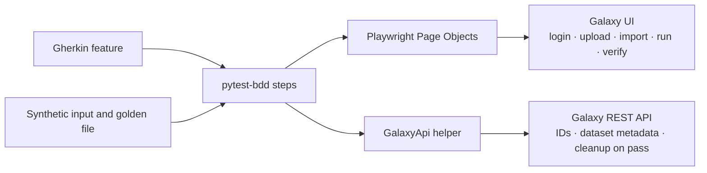
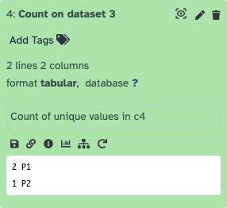
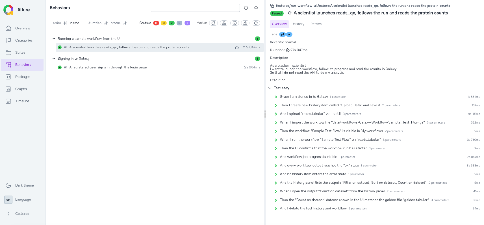

[](https://github.com/GB-A/galaxy-workflow-qa/actions/workflows/galaxy-tests.yml)

# 🧬 Galaxy Workflow QA

This repository contains Python-based automated tests for a locally hosted
Galaxy instance. The current executable UI scenarios cover signing in,
uploading a synthetic tabular dataset, importing and running a Galaxy workflow,
observing its progress, and checking the output against a golden file.

The test fixtures are synthetic. Do not commit production credentials, API
keys, or sensitive datasets.

The [test-case catalogue](docs/test-cases.md) describes the broader coverage
plan; some listed cases are planned and are not necessarily implemented by the
current executable suite.

## 🧭 Contents

- [🧰 Framework choices](#framework-choices)
- [📁 Repository layout](#repository-layout)
- [⚙️ Prerequisites](#prerequisites)
- [🚀 Local setup](#local-setup)
  - [🐳 Start Galaxy](#start-galaxy)
- [🧪 Run tests](#run-tests)
  - [🧭 UI and API responsibilities](#ui-and-api-responsibilities)
  - [🖥️ Example UI result](#example-ui-result)
- [📊 Test reports](#test-reports)
  - [🧾 Allure sample report](#allure-sample-report)
- [🔄 GitHub Actions](#github-actions)
- [🛠️ Troubleshooting](#troubleshooting)

<a id="framework-choices"></a>
## 🧰 Framework choices

| Choice | Reason |
| --- | --- |
| Python and pytest | Fixture support and one runner for UI tests and their supporting resource operations. |
| pytest-bdd and Gherkin | Keeps scenarios readable as user workflows and maps feature steps to Python implementations. |
| Playwright for Python, synchronous API | Uses browser auto-waiting and accessible locators. The synchronous style matches the current pytest-bdd execution model. |
| Page Object Model | Encapsulates Galaxy page locators and actions so scenarios focus on test intent and assertions. |
| Galaxy API helper | Used from the UI scenario to resolve resource IDs, identify the uploaded dataset, and clean up test-owned resources after success. It does not launch or verify the workflow and is not a separate API test. |
| Allure and pytest-html | Provides step-oriented reports and attachments alongside a self-contained HTML report. |

Playwright `expect()` assertions use the default timeout in `pytest.ini`:
`playwright_expect_timeout_ms = 120000`. This is an assertion timeout, not a
whole-test or action timeout.

<a id="repository-layout"></a>
## 📁 Repository layout

```text
.
├── .github/workflows/
│   └── galaxy-tests.yml             # GitHub Actions CI workflow
├── conftest.py                      # Shared auth, timeout, and failure-report fixtures/hooks
├── data/
│   ├── reads.tabular                # Synthetic workflow input
│   ├── golden.tabular               # Expected count output
│   └── workflows/                   # Workflow import fixture(s)
├── docs/
│   ├── README.md                    # Link to this guide
│   ├── test-cases.md                # Test-case catalogue and coverage plan
│   └── images/                      # README screenshots
├── functional_playwright/
│   ├── features/                    # Gherkin feature files
│   ├── pages/                       # Page Objects and data-peek assertion helper
│   ├── tests/                       # pytest-bdd step definitions
│   └── galaxy_api.py                # Authenticated Galaxy resource lookup and cleanup
├── pytest.ini                       # Pytest, Playwright, BDD, and report configuration
└── requirements.txt                 # Python test dependencies
```

<a id="prerequisites"></a>
## ⚙️ Prerequisites

- Python 3.13 (the version used by CI)
- Docker, to run the local Galaxy test instance
- Node.js and npm, if generating Allure reports locally with the Allure CLI
- A desktop display for headed local browser runs; Linux CI uses Xvfb

<a id="local-setup"></a>
## 🚀 Local setup

Create and activate a virtual environment, then install the test dependencies
and Playwright Chromium:

```bash
python3.13 -m venv .venv
source .venv/bin/activate
python -m pip install --upgrade pip
python -m pip install -r requirements.txt
python -m playwright install chromium
```

Create a local environment file from the template:

```bash
cp .env.example .env
```

Set `GALAXY_TEST_USERNAME` and `GALAXY_TEST_PASSWORD` in `.env`. The same
credentials must be used for the Galaxy test account. `.env` is ignored by Git;
never commit real credentials.

<a id="start-galaxy"></a>
### 🐳 Start Galaxy

The CI workflow runs `quay.io/bgruening/galaxy:latest` and maps container port
80 to local port 8080. For a local instance with the same configuration, load
the variables from `.env` into the shell and start the container:

```bash
set -a
source .env
set +a

docker run --detach \
  --name galaxy-local \
  --publish 8080:80 \
  --env GALAXY_DEFAULT_ADMIN_USER="${GALAXY_TEST_USERNAME}" \
  --env GALAXY_DEFAULT_ADMIN_EMAIL=admin@galaxy.org \
  --env GALAXY_DEFAULT_ADMIN_PASSWORD="${GALAXY_TEST_PASSWORD}" \
  --env GALAXY_DEFAULT_ADMIN_KEY=fakekey \
  --env GALAXY_CONFIG_ADMIN_USERS=admin@galaxy.org \
  quay.io/bgruening/galaxy:latest
```

The container configuration sets up the test admin account using the supplied
username and password. Do not rely on image default credentials.

Wait for Galaxy's API to respond:

```bash
curl --fail http://127.0.0.1:8080/api/version
```

Pytest expects Galaxy at `http://localhost:8080`, as configured in `pytest.ini`.
Stop the local container when finished:

```bash
docker rm --force galaxy-local
```

<a id="run-tests"></a>
## 🧪 Run tests

Run the complete collected suite:

```bash
pytest --clean-alluredir
```

Run one scenario file:

```bash
pytest --clean-alluredir functional_playwright/tests/test_login.py
pytest --clean-alluredir functional_playwright/tests/test_run_workflow_ui.py
```

The pytest configuration enables headed Playwright execution by default, so
local runs need a graphical display. On headless Linux, use Xvfb as CI does:

```bash
xvfb-run --auto-servernum pytest --clean-alluredir
```

The workflow UI scenario creates a timestamped history and imports a
timestamped copy of the `.ga` workflow. It uploads `data/reads.tabular`, checks
the workflow progress and output states, and compares the count output with
`data/golden.tabular`. Its final step deletes the test history and workflow
after all assertions pass. If a test fails before that step, the resources are
retained for investigation; the failure report includes the workflow and
dataset identifiers.

<a id="ui-and-api-responsibilities"></a>
### 🧭 UI and API responsibilities

The scenario drives login, upload, workflow import, execution, and result
verification through Playwright and the Galaxy UI. The `GalaxyApi` helper is
called from that same UI scenario only for resource metadata and lifecycle
cleanup:



Workflow deletion is an API cleanup operation invoked at the end of the UI
scenario, not an API test. A failed assertion prevents the final cleanup step
from running, leaving the workflow and history available for investigation.

<a id="example-ui-result"></a>
### 🖥️ Example UI result

This screenshot shows the synthetic `Count on dataset` result in Galaxy. The
test compares its rows with `data/golden.tabular`.



<a id="test-reports"></a>
## 📊 Test reports

Pytest is configured to create:

- `reports/myreport.html` — self-contained pytest HTML report
- `reports/allure-results/` — raw Allure result files and attachments

Failure reports include a screenshot. Workflow scenario failures also include
the workflow ID, dataset name and IDs, and history details.

<a id="allure-sample-report"></a>
### 🧾 Allure sample report

The sample below shows a **passed** workflow scenario in Allure's Behaviors
view. It displays the feature and scenario names, status, duration, tags, and
the expanded BDD step list with individual timings.



The scenario shown is **A scientist launches reads_qc, follows the run and
reads the protein counts**, under **Running a sample workflow from the UI**.
Its steps are:

1. Sign in to Galaxy.
2. Create and name a history.
3. Upload `reads.tabular` through the UI.
4. Import `data/workflows/Galaxy-Workflow-Sample_Test_Flow.ga`.
5. Verify `Sample Test Flow` appears in My workflows.
6. Launch `Sample Test Flow` with `reads.tabular`.
7. Confirm the workflow run has started.
8. Verify that job progress is visible.
9. Wait for every workflow output to reach `ok`.
10. Verify that no history item is in the error state.
11. Verify that Filter, Sort, and Count outputs are listed in the history.
12. Open the `Count on dataset` output.
13. Compare its UI data peek with `data/golden.tabular`.
14. Delete the successful run's history and workflow. This final cleanup step
    uses the authenticated Galaxy API helper; it is not an API test.

With the Allure CLI installed, generate and open a static report:

```bash
npx allure generate reports/allure-results \
  --output reports/allure-html-report \
  --clean
npx allure open reports/allure-html-report
```

To serve raw results in a temporary local report:

```bash
npx allure serve reports/allure-results
```

Use `--clean-alluredir` for local runs to remove previous Allure result files
before the current run.

<a id="github-actions"></a>
## 🔄 GitHub Actions

The [`Galaxy integration tests` workflow](.github/workflows/galaxy-tests.yml)
runs on pushes, pull requests, and manual dispatch. It:

1. Sets up Python 3.13 and Node.js 20 and installs project dependencies.
2. Installs Playwright browsers and their system dependencies.
3. Starts a disposable `quay.io/bgruening/galaxy:latest` container, maps port
   80 to 8080, and waits for `/api/version`.
4. Creates the test admin account using the Actions username variable and
   password secret. The account email is `admin@galaxy.org`.
5. Runs pytest under Xvfb. The test step continues after a failure so report
   generation and artifact upload can still run; the workflow is marked failed
   afterward if pytest failed.
6. Generates `reports/allure-html-report/`, uploads it with
   `reports/allure-results/` as the `allure-report` artifact (14-day retention),
   and attempts to deploy the HTML report to GitHub Pages.
7. Stops the Galaxy container and includes a conditional step to show its logs on failure.

Configure these values in **Settings > Secrets and variables > Actions**:

- `GALAXY_TEST_USERNAME` as an Actions variable
- `GALAXY_TEST_PASSWORD` as an Actions secret

The image documents default credentials (`admin` / `password`), but the
workflow overrides them with the configured test username and password. Pull
requests from forks do not receive repository secrets by default, so
login-dependent scenarios cannot authenticate in those runs without an
approved non-secret test credential strategy.

After a workflow run, download the `allure-report` artifact from the run's
**Artifacts** section. The report is generated at
`reports/allure-html-report/index.html` in the job workspace and is included in
the artifact as `allure-html-report/index.html`; raw Allure results are included
as well.

The workflow also configures an Allure pull-request summary step. Its
`report-directory` currently differs from the HTML output directory; if the PR
summary is missing, check those paths in the workflow.

Playwright runs headed under Xvfb in CI. Locally, headed mode is enabled by
default through pytest configuration.

<a id="troubleshooting"></a>
## 🛠️ Troubleshooting

- **Missing credentials:** verify both variables in `.env` locally, or in
  Actions variables/secrets in CI.
- **Galaxy is unavailable:** confirm the container is running and
  `http://127.0.0.1:8080/api/version` responds.
- **Browser launch fails on Linux:** install the Playwright browser
  dependencies and run headed tests under Xvfb.
- **Need to inspect a failed workflow:** use the workflow ID and dataset
  identifiers in the Allure failure context to locate the retained Galaxy
  resources.
- **Stale Allure results:** use `pytest --clean-alluredir` before generating a
  report.
